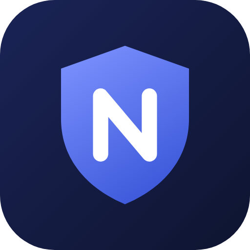
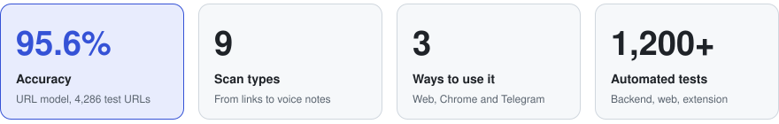
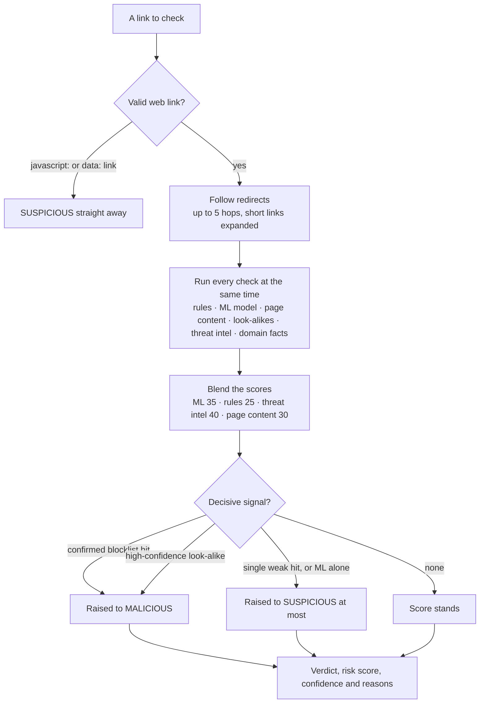

<p align="center">
  
</p>

<h1 align="center">NexGuard AI</h1>

<p align="center">
  <b>AI-powered phishing and scam detection.</b><br>
  Check a link, email, QR code, screenshot, voice note or photo and get a clear verdict with the reasons,<br>
  from the web dashboard, a Chrome extension or a Telegram bot.
</p>

<p align="center">
  <a href="https://github.com/smitlalvadiya7-ui/NexGuard_v-2.0/actions/workflows/ci.yml"></a>
  <a href="#accuracy"></a>
  
  
  
  
  
  <a href="LICENSE"></a>
</p>

<p align="center">
  <a href="INSTALL.md">Install guide</a> ·
  <a href="#quick-start">Quick start</a> ·
  <a href="USAGE.md">Usage guide</a> ·
  <a href="#how-it-works">How it works</a> ·
  <a href="#accuracy">Accuracy</a> ·
  <a href="#privacy-what-leaves-your-machine">Privacy</a> ·
  <a href="#roadmap">Roadmap</a>
</p>

> **Demo build.** The Premium plan is for demonstration only. **No payment is
> taken.** Premium access is granted free by an admin on request.

| | |
|---|---|
| **What** | A phishing and scam checker: give it something suspicious and it returns **SAFE**, **SUSPICIOUS** or **MALICIOUS**, a 0 to 100 risk score, a confidence level and the reasons |
| **For** | Anyone who gets suspicious links, emails, QR codes, calls or messages, and the admins who look after those users |
| **Reads** | Web links, `.eml` files, pasted emails, your Gmail inbox, QR code photos, screenshots, voice recordings and photos |
| **Finds** | Look-alike domains, blocklisted links, fake login pages, spoofed senders, scam wording in text and speech, and AI-generated images |
| **Gives you** | A verdict on the dashboard, a warning page in Chrome, a reply on Telegram, scan history and a downloadable PDF report |

## At a glance

<picture>
  <source media="(prefers-color-scheme: dark)" srcset="docs/assets/at-a-glance-dark.svg">
  
</picture>

<sub>Accuracy is the URL model's score on 4,286 held-out test URLs that it never saw during training.
<a href="#accuracy">How it was measured</a>.</sub>

## Contents

- [Why NexGuard](#why-nexguard)
- [What it checks](#what-it-checks)
- [Features](#features)
- [How it works](#how-it-works)
- [Requirements](#requirements)
- [Quick start](#quick-start)
- [Reading the result](#reading-the-result)
- [Accuracy](#accuracy)
- [Privacy: what leaves your machine](#privacy-what-leaves-your-machine)
- [Limitations](#limitations)
- [Project layout](#project-layout)
- [Development](#development)
- [Roadmap](#roadmap)
- [Credits](#credits)
- [Disclaimer](#disclaimer)
- [License](#license)

## Why NexGuard

Most scams arrive the same way: a link in an SMS, an "urgent" email from a bank,
a QR code on a poster, a call asking for an OTP. Checking one properly means
reading domains letter by letter, opening email headers and pasting the link into
several websites. Most people skip that step, and that is the step scammers count on.

NexGuard does those checks in a few seconds, the same way every time, and says
in plain words why it reached its verdict.

| Checking it yourself | With NexGuard |
|---|---|
| Read the domain letter by letter to spot `paypa1` or `icici-verify` | Look-alike check against 71 brands, including swapped letters and homoglyphs |
| Paste the link into VirusTotal, then Google, then URLhaus | One scan asks every threat-intel source at the same time |
| Open the email headers to see who really sent it | The sender is matched against the brand's real domains, and SPF, DKIM and DMARC are read for you |
| Scan an unknown QR code and hope for the best | Upload a photo of the QR code; the link inside is checked before you open it |
| Replay a call to decide whether it was a scam | Upload the recording; the speech is turned into text and checked for scam phrases |
| Guess whether a photo is real | File metadata is checked for proof, then an AI-image model gives its estimate |

## What it checks

| Scan | Input | What it checks |
|---|---|---|
| **URL** | Any web link | Domain reputation, look-alike (typosquat) domains, domain age, SSL certificate, redirects, page content, ML model score |
| **QR code** | Image containing a QR code | Decodes the QR and scans the hidden link |
| **Email** | `.eml` file or pasted email | Sender authenticity (SPF / DKIM / DMARC), scam wording, every link inside the email |
| **Gmail inbox** | Your Gmail account (optional) | Scans recent inbox emails in one click |
| **Screenshot** | Image of a chat, SMS or web page | Reads the text (OCR), scores it for scam patterns and scans any link it finds |
| **Voice** | Audio file or voice note | Transcribes the speech, scores it for scam phrases and scans any link that is read out |
| **AI image** | Any photo | Estimates whether the image is AI-generated or a real photo |
| **Batch** | Up to 200 URLs at once | Bulk URL scan with CSV and PDF export (Premium) |
| **Live protection** | Your microphone (Chrome) | Listens to a call on speaker and warns aloud when scam phrases are heard |

## Features

- **Dashboard**: scan statistics, verdict charts, threat map, live threat feed and real-time alerts
- **Activity**: full scan history with re-scan, and a watchlist that re-checks saved URLs (Premium)
- **Reports**: downloadable PDF forensic report for any scan
- **Chrome extension**: checks every page before it opens, marks risky links on hover, warns on suspicious senders in Gmail / Outlook web, and adds right-click scanning
- **Telegram bot**: send a link, photo, voice note or `.eml` file and get the verdict in chat
- **Developer API**: create personal API keys and scan URLs from your own scripts
- **Support**: built-in help chat and support tickets
- **Admin panel**: manage users, roles and plans, approve Premium requests, review feedback and tickets; superadmins also see the audit log

### Plans

| | Free | Premium (Demo) |
|---|---|---|
| Daily scans | 10 per day (5 per day without login) | Unlimited |
| Report detail | Verdict, score, confidence and reasons | Everything in Free plus IP, location, WHOIS, SSL details, redirect chain and live page preview |
| Batch scan and watchlist | — | ✓ |
| How to get it | Sign up | **Settings → Request Premium**; an admin approves it. **No payment.** |

### User roles

| Role | Access |
|---|---|
| User | Own scans, history, reports and settings |
| Admin | Everything a user can do, plus the Admin panel |
| Superadmin | Everything an admin can do, plus managing admins and the audit log |

## How it works

<picture>
  <source media="(prefers-color-scheme: dark)" srcset="docs/assets/how-it-works-dark.svg">
  
</picture>

Every link, whether you typed it or NexGuard found it in an email, a screenshot,
a QR code or a voice note, goes through the same scoring engine:



1. **Read.** A QR code is decoded with OpenCV. A screenshot is read with Tesseract
   OCR. A voice note is transcribed on your machine by Whisper, which translates
   any spoken language into English so one set of scam rules covers Hindi,
   Gujarati and others. An email is parsed from the `.eml` file, the pasted text or
   your Gmail inbox.
2. **Extract.** Links are pulled out of the text, including links that OCR split
   across two lines. Redirects are followed for up to 5 hops and short links are
   expanded. From an email, the sender, the display name and the SPF, DKIM and
   DMARC results are taken. When there are no headers (a screenshot or a pasted
   address), the sender domain's DNS records (DMARC, SPF, MX) are checked instead.
3. **Check.** Six checks run in parallel. Each has a time limit, so one slow
   source cannot hold up the scan.
   - **Rules**: URL tricks (IP addresses, `@` signs, risky extensions, shorteners) and scam keywords
   - **ML model**: a character-level text model trained on a 21,427-URL dataset
   - **Page content**: the page is fetched once and read without running its JavaScript, looking for password fields, forms that post to another site and brand names that do not match the domain
   - **Look-alikes**: typosquats, swapped letters and homoglyphs, checked against 71 brands
   - **Threat intel**: VirusTotal, Google Safe Browsing, URLhaus, OpenPhish and Phishing.Database
   - **Domain facts**: domain age (WHOIS), SSL certificate, DNS and server location
4. **Score.** The results are blended into a 0 to 100 risk score: ML model 35,
   rules 25, threat intel 40 and page content 30. Threat intel only counts when a
   source actively flags the link, and the page content only counts when the page
   gives a clear signal. A source that is silent or unreachable is left out
   instead of being counted as "clean", so a brand-new phishing link is never
   pulled toward SAFE just because no blocklist knows it yet. Decisive signals then
   set a minimum: a confirmed blocklist hit raises the score to MALICIOUS, while a
   single weak hit or a high ML score on its own stops at SUSPICIOUS.
5. **Verdict.** 70 and above is **MALICIOUS**, 40 to 69 is **SUSPICIOUS** and
   below 40 is **SAFE**. A confidence level says how strongly the available
   signals agree, and it drops when a source could not be reached.
6. **Deliver.** The result is saved to your history and shown on the dashboard,
   on the Chrome extension's warning page or as a Telegram reply. Any scan can be
   downloaded as a PDF report.

Emails, screenshots and voice notes are also scored on their own words (pressure
tactics, OTP and password requests, prize and job scams). When they contain
links, each link is scanned as above and the higher risk wins. Photos take a
separate path: metadata proof first (camera EXIF, AI-generator tags, C2PA
content credentials), then a local AI-image model for an estimate.

## Requirements

| | Minimum | Recommended |
|---|---|---|
| OS | Windows 10 / 11, Linux or macOS | Windows 11 |
| Python | 3.12 | 3.12 or newer |
| Node.js | 22 | 22 LTS or newer |
| RAM | 4 GB | 8 GB (voice and AI-image models) |
| Disk | 4 GB free | 6 GB free |
| Browser | Chrome or Edge | Latest Chrome |

Optional tools: **Tesseract OCR** (screenshot scans), **ffmpeg** (mp3 / mp4 voice files),
**Ollama** (free AI answers in the support chat).

API keys for VirusTotal, Google Safe Browsing, URLhaus and urlscan.io are
optional and all have a free plan. Without them NexGuard still works on its own
rules and ML model. See [INSTALL.md](INSTALL.md#3-configure-your-settings).

## Quick start

On Windows:

```cmd
git clone https://github.com/smitlalvadiya7-ui/NexGuard_v-2.0.git
cd NexGuard_v-2.0
copy backend\.env.example backend\.env
```

Open `backend\.env` and fill in the required settings (`JWT_SECRET`,
`ADMIN_PASSWORD`, `SUPERADMIN_PASSWORD`). Then build the dashboard and start:

```cmd
cd frontend
npm ci
npm run build
cd ..
run.cmd
```

The first run installs the Python dependencies and takes a few minutes. When you
see `Dashboard : http://127.0.0.1:8000`, open that address in your browser.

Linux and macOS steps, the Chrome extension and the Telegram bot are covered in
[INSTALL.md](INSTALL.md). Every feature is explained step by step in [USAGE.md](USAGE.md).

## Reading the result

This is the real output for the bundled sample `testdata/emails/phishing_fake_bank.eml`
(the reason list is shortened):

```text
From     ICICI Bank <security@icici-verify.top>
Verdict  MALICIOUS    risk score 100 / 100

Why
  - Claims to be 'icici' but was sent from 'icici-verify.top', which does not
    belong to icici (official: icici.bank.in, icicibank.com).
  - Scam-intent cues detected: account has been suspended, suspicious activity,
    immediately, urgent, within 24 hours, verify now
  - Email directly requests credentials/OTP
  - URL indicator: URL uses insecure HTTP
  - URL indicator: Suspicious domain extension
  - URL indicator: ML model phishing probability: 99%
  ... and 11 more
```

The genuine sample `testdata/emails/genuine_google_security.eml` comes back
**SAFE** with a risk score of 0.

| Verdict | Risk score | What to do |
|---|---|---|
| **SAFE** | 0 to 39 | No known warning signs were found. Still never share an OTP, password or card details on request. |
| **SUSPICIOUS** | 40 to 69 | Do not enter any details. Check through the official app or website instead of the link. |
| **MALICIOUS** | 70 to 100 | Do not open it. Delete or report the message. |

Each result also shows a **confidence** level. Low confidence means some
sources could not be reached, so treat the verdict with more care.

## Accuracy

**95.6%**

The URL model labelled 95.6% of 4,286 held-out test URLs correctly. The dataset
has 21,427 URLs (10,715 phishing and 10,712 legitimate). 20% of it was set aside
before training and used only for this test.

The number above is for the ML model. A full scan adds rules, page checks,
look-alike detection and threat intel on top of it.

## Privacy: what leaves your machine

| Service | What it receives | When |
|---|---|---|
| VirusTotal | The link, or a file's SHA-256 hash (files are never uploaded) | URL scans and email attachments |
| Google Safe Browsing | The link | URL scans |
| URLhaus (abuse.ch) | The link | URL scans |
| urlscan.io | The link, submitted as *unlisted* | Single URL scans, for the page preview; skipped for well-known sites |
| WHOIS and ip-api.com | The domain name | URL scans |
| The website being scanned | One normal page request; its JavaScript is never run | URL scans; skipped for well-known sites |
| Gmail (optional) | Read-only access to your own inbox through Google's API | Only when you scan your inbox |
| Support chat AI (optional) | Your question | Only if a Claude API key is set; Ollama runs on your machine |
| Telegram | What you send to the bot | Only when you use the bot |

OpenPhish and Phishing.Database receive nothing: their public feeds are
downloaded and matched on your machine. Screenshots (OCR), voice notes (Whisper),
photos (AI-image model), email text and your scan history stay on your machine.

## Limitations

- No scanner can catch every threat. **SAFE** means no known warning signs were found, not a guarantee.
- The hardest case is a brand-new phishing link that no blocklist has seen yet, hosted on a normal-looking domain or a free hosting platform. Some of these get through.
- Pages are read without running JavaScript, so content that only a script builds is not seen.
- AI-image results are an estimate unless the file carries metadata proof. Edited or re-saved images are harder to judge.
- Screenshot and voice results depend on image and audio quality.
- Threat-intel sources are used on their free plans, which have rate limits. When a source is unavailable, the confidence drops instead of the verdict changing.
- Premium is a demo: no payments are taken.

## Project layout

```text
NexGuard_v-2.0/
├── backend/                FastAPI server and scan engine
│   ├── main.py               API routes
│   ├── aggregator.py         URL pipeline: parallel checks, scoring, verdict
│   ├── ai_engine.py          rule-based URL checks
│   ├── email_analyzer.py     sender checks, SPF / DKIM / DMARC, scam wording
│   ├── ocr_analyzer.py       screenshot text (Tesseract)
│   ├── voice_analyzer.py     speech to text (Whisper) and scam phrases
│   ├── image_origin.py       AI-generated or real photo
│   ├── qr_scanner.py         QR code decoding
│   ├── telegram_bot.py       Telegram bot
│   ├── report_generator.py   PDF reports
│   ├── apis/                 threat intel, WHOIS, SSL, DNS and look-alike checks
│   ├── ml/                   URL model: training, prediction, explanations
│   ├── eval/                 accuracy and real-world evaluation scripts
│   └── tests/                pytest suite
├── frontend/               React dashboard (Vite, Tailwind CSS)
├── extension/              Chrome extension (Manifest V3)
├── testdata/               sample emails, QR codes, screenshots, voice clips and images
├── docs/                   README images and logo
├── run.cmd                 one-command start on Windows
└── docker-compose.yml      container setup
```

## Development

```bash
# Backend (from the project folder)
python -m pytest

# Chrome extension
node --test extension/tests/*.cjs

# Dashboard
cd frontend
npm test
```

All three suites run on every push through GitHub Actions.

## Roadmap

- [x] Scans for links, emails, QR codes, screenshots, voice notes and photos
- [x] Chrome extension and Telegram bot
- [x] Accounts and roles, scan history, watchlist, PDF reports and a developer API
- [x] Docker setup and CI on every push
- [ ] Public website on its own domain
- [ ] Chrome Web Store release
- [ ] Always-on Telegram bot on the live server

## Credits

- AI-image detection model: [umm-maybe/AI-image-detector](https://huggingface.co/umm-maybe/AI-image-detector), licensed [CC BY 4.0](https://creativecommons.org/licenses/by/4.0/)
- Domain popularity list: [Tranco](https://tranco-list.eu/)
- Threat intelligence: VirusTotal, Google Safe Browsing, URLhaus (abuse.ch), OpenPhish,
  Phishing.Database, urlscan.io and ip-api.com, each used under its own terms for
  non-commercial use

## Disclaimer

No scanner can catch every threat. A **SAFE** verdict means no known warning signs
were found; it is **not a guarantee**. Always double-check before you share
passwords, OTPs or payment details.

## License

Copyright © 2026 Smit Lalvadiya. All rights reserved. See [LICENSE](LICENSE).
