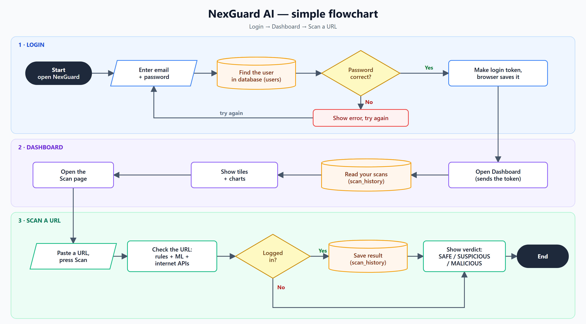

# NexGuard AI

AI-powered phishing and scam detection for links, emails, QR codes, screenshots,
voice messages and images, available as a web dashboard, a Chrome extension and a
Telegram bot.

> **Demo build.** The Premium plan is for demonstration only. **No payment is
> taken.** Premium access is granted free by an admin on request.

## How it works

1. **Login**: sign in with email and password; the browser keeps a secure session token.
2. **Dashboard**: your past scans become stat tiles and charts.
3. **Scan**: the input is checked with detection rules, a machine-learning model and
   threat-intelligence sources, then saved to your history with a verdict.

Every scan returns a verdict of **SAFE**, **SUSPICIOUS** or **MALICIOUS**, a risk score
(0–100), a confidence level and the reasons behind the result.

---

## Specifications

### Scan types

| Scan | Input | What it checks |
|---|---|---|
| **URL** | Any web link | Domain reputation, look-alike (typosquat) domains, domain age, SSL certificate, redirects, page content, ML model score |
| **QR code** | Image containing a QR code | Decodes the QR and scans the hidden link |
| **Email** | `.eml` file or pasted email | Sender authenticity (SPF / DKIM / DMARC), scam wording, every link inside the email |
| **Gmail inbox** | Your Gmail account (optional) | Scans recent inbox emails in one click |
| **Screenshot** | Image of a chat, SMS or web page | Reads the text (OCR) and scores it for scam patterns |
| **Voice** | Audio file or voice note | Transcribes speech (Hindi and English) and scores it for scam phrases |
| **AI image** | Any photo | Estimates if the image is AI-generated or a real photo |
| **Batch** | Up to 200 URLs at once | Bulk URL scan with CSV and PDF export (Premium) |
| **Live protection** | Your microphone (Chrome) | Listens to a call on speaker and warns aloud when scam phrases are heard |

### Features

- **Dashboard**: scan statistics, verdict charts, threat map, live threat feed and real-time alerts
- **Activity**: full scan history with re-scan, and a watchlist that re-checks saved URLs (Premium)
- **Reports**: downloadable PDF forensic report for any scan
- **Chrome extension**: checks every page before it opens, marks risky links on hover, warns on suspicious senders in Gmail / Outlook web, and adds right-click scanning
- **Telegram bot**: send a link, photo, voice note or `.eml` file and get the verdict in chat
- **Developer API**: create personal API keys and scan URLs from your own scripts
- **Support**: built-in help chat and support tickets
- **Admin panel**: manage users, roles and plans, approve Premium requests, review feedback and tickets; superadmins also see the audit log

### Plans

| | Free | Premium (Demo) |
|---|---|---|
| Daily scans | 10 per day (5 per day without login) | Unlimited |
| Report detail | Verdict, score, confidence and reasons | Everything in Free plus IP, location, WHOIS, SSL details, redirect chain and live page preview |
| Batch scan and watchlist | — | ✓ |
| How to get it | Sign up | **Settings → Request Premium**; an admin approves it. **No payment.** |

### User roles

| Role | Access |
|---|---|
| User | Own scans, history, reports and settings |
| Admin | Everything a user can do, plus the Admin panel |
| Superadmin | Everything an admin can do, plus managing admins and the audit log |

### System requirements

| | Minimum | Recommended |
|---|---|---|
| OS | Windows 10 / 11, Linux or macOS | Windows 11 |
| Python | 3.12 | 3.12 or newer |
| Node.js | 22 | 22 LTS or newer |
| RAM | 4 GB | 8 GB (voice and AI-image models) |
| Disk | 4 GB free | 6 GB free |
| Browser | Chrome or Edge | Latest Chrome |

Optional tools: **Tesseract OCR** (screenshot scans), **ffmpeg** (mp3 / mp4 voice files),
**Ollama** (free AI answers in the support chat).

---

## Get started

- **[INSTALL.md](INSTALL.md)**: what to install and how to run NexGuard
- **[USAGE.md](USAGE.md)**: step-by-step guide for every task

## Credits

- AI-image detection model: [umm-maybe/AI-image-detector](https://huggingface.co/umm-maybe/AI-image-detector), licensed [CC BY 4.0](https://creativecommons.org/licenses/by/4.0/)
- Domain popularity list: [Tranco](https://tranco-list.eu/)
- Threat intelligence: VirusTotal, Google Safe Browsing, URLhaus (abuse.ch), OpenPhish,
  Phishing.Database, urlscan.io and ip-api.com, each used under its own terms for
  non-commercial use

## Disclaimer

No scanner can catch every threat. A **SAFE** verdict means no known warning signs
were found; it is **not a guarantee**. Always double-check before you share
passwords, OTPs or payment details.

## License

Copyright © 2026 Smit Lalvadiya. All rights reserved. See [LICENSE](LICENSE).
